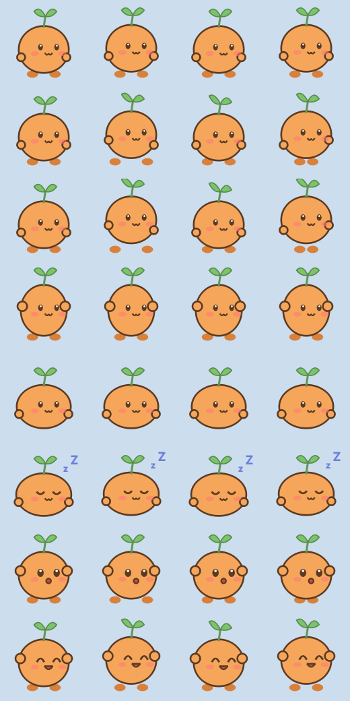

# 🌱 데스크톱 펫 "콩이"

Windows 화면 위를 돌아다니며 걷고, 뛰고, 점프하고, 앉고, 잠도 자는 작은 친구예요.
작업표시줄 바로 위를 땅으로 삼아서 돌아다녀요.



## 실행 방법 (Windows)
1. [Python](https://www.python.org/downloads/)을 설치하세요. 설치할 때 **"Add python.exe to PATH"**를 꼭 체크하세요.
2. 이 `desktop-pet` 폴더에서 **`run.bat`**을 더블클릭하세요.
   처음 실행할 때 PySide6를 자동으로 설치해요. 1~2분 정도 걸릴 수 있어요.

직접 실행하려면 이렇게 하세요:
```
pip install -r requirements.txt
python pet.py
```

## 조작
| 동작 | 반응 |
|---|---|
| 왼쪽 클릭 | 깡총 뛰며 하트를 띄워요 |
| 드래그 | 집어서 옮겨요. 던지면 날아가서 떨어져요 |
| 오른쪽 클릭 | 메뉴: 앉아 / 자 / 점프 / 산책 / 마우스 따라오기 / 크기 / 친구 하나 더 / 종료 |
| 트레이 아이콘 | 친구 추가, 종료 |

## 내 그림으로 바꾸기
`sprites/` 폴더에 투명 배경 PNG를 `idle_1.png`, `walk_1.png`, `walk_2.png` 같은 이름으로 넣으면 그 그림으로 움직여요.
자세한 규칙은 `sprites/README.txt`에 있어요. 그림은 **오른쪽을 보는 방향**으로 그리면 돼요. 왼쪽으로 갈 때는 자동으로 뒤집어요.

## 설정 바꾸기
`pet.py` 맨 위 **설정** 부분을 고치면 돼요.
- `BASE_SIZE` : 캐릭터 크기
- `WALK_SPEED`, `RUN_SPEED` : 걷기·뛰기 속도
- `JUMP_POWER`, `GRAVITY` : 점프 높이, 중력
- `NEXT_STATE` : 다음 동작이 나올 확률 (예: `sleep` 숫자를 키우면 잠꾸러기가 돼요)

## exe로 만들기 (선택)
```
pip install pyinstaller
pyinstaller --noconsole --onefile --add-data "sprites;sprites" pet.py
```
`dist/pet.exe`가 만들어져요. 이 파일만 있으면 Python 없이도 실행돼요.
시작할 때 자동으로 켜지게 하려면 `Win + R` → `shell:startup`을 열고 그 폴더에 바로가기를 넣으세요.
